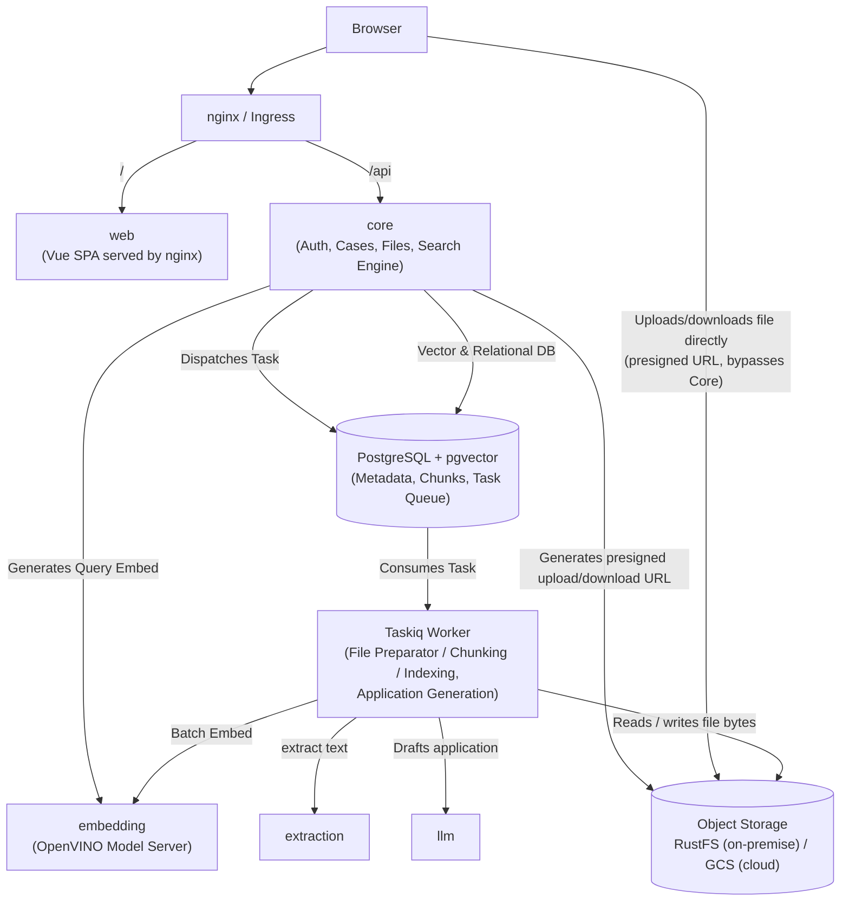
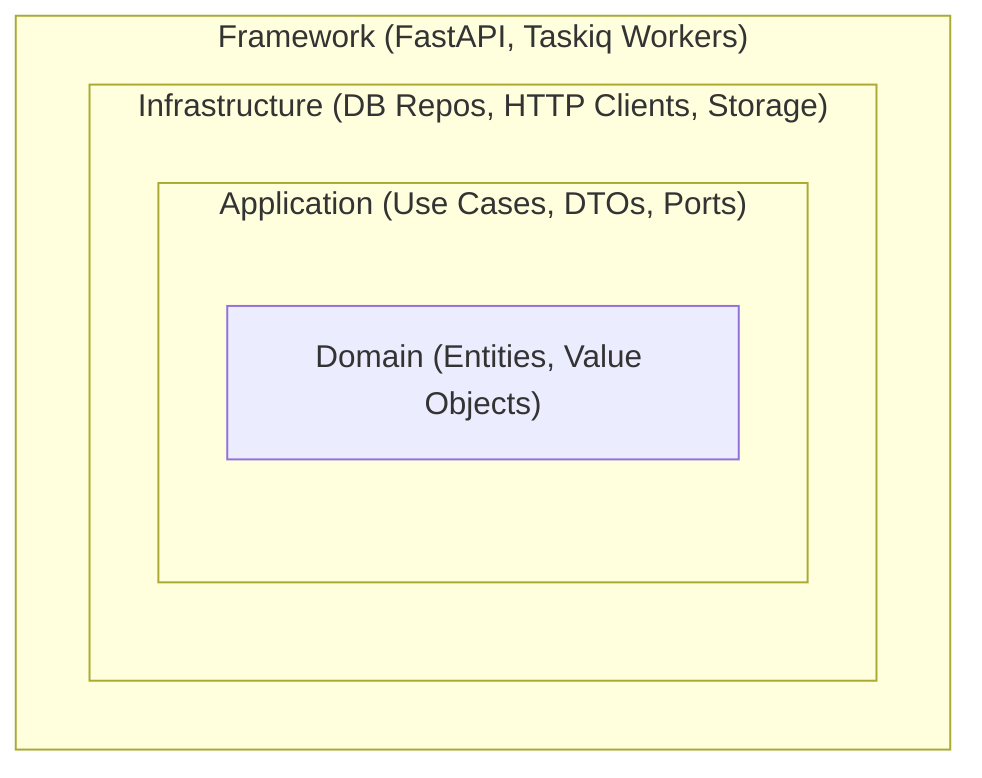

# Application Architecture

## 1. Introduction and System Overview

**Prawobiorca** is a modern web application providing intelligent legal search and document management capabilities. The system supports AI-assisted (semantic vector search) retrieval of legal acts, as well as case management and document drafting for authenticated users.

The whole application lives in a single repository: the Python backend services described below, and the Vue frontend (`apps/web`) documented in [Frontend](frontend.md).

Repository layout:
- `apps/` – deployable applications, each built into its own container image: `core` (main API and Taskiq worker), `extraction`, `embedding` and `web` (frontend).
- `deploy/` – Kubernetes manifests for the local (Podman) and GCP environments.
- `scripts/` – scripts for running the application locally and deploying it to the cloud.
- `docs/` – this documentation.

Code shared between applications, such as the generated API client, will be moved to `packages/` next to `apps/` once a second application needs it.

The system is designed to run in two primary environments:
- **Cloud (GCP / Google Cloud Platform)**: Utilizing containerized workloads with scale-to-zero capabilities for resource-heavy operations to optimize cost and resource allocation.
- **On-Premise**: Running containerized services using **Podman** / Docker.

---

## 2. System Architecture & Components

The architecture follows a **Monolith** pattern for core business logic, paired with **specialized microservices** for compute-heavy tasks:

### 2.1. `core` (Main API & Taskiq Worker)
Hosts the core domain logic, user-facing endpoints, and background document indexing within a single modular codebase:
* **Core API (FastAPI)**:
  * User authentication, authorization, and profile management.
  * Case (*Sprawy*) management and document metadata handling (filenames, upload status, permissions).
  * Storage orchestration: generates presigned upload/download URLs (S3 presigned POST/GET) so the browser transfers file bytes directly with object storage — `core` never proxies the bytes itself. The Taskiq worker separately reads the raw bytes back from storage for processing.
  * Fast synchronous search execution: requests single query embeddings from `embedding` and performs vector similarity search against PostgreSQL (`pgvector`).
  * Dispatches asynchronous file processing tasks using **Taskiq**, automatically upon upload confirmation — no separate request is needed to start indexing. The task is written to PostgreSQL in the same transaction that marks the document as in progress.
  * Dispatches application (*wniosek*) generation tasks the same way: the application is saved with the `IN_PROGRESS` status and the task is written in the same transaction; the endpoint returns immediately and the frontend polls the status.
* **File Preparator (Taskiq Worker)**:
  * Consumes document preparation jobs from the PostgreSQL task queue.
  * Coordinates document processing pipeline: sends file to `extraction`, chunks structured text, requests batch embeddings from `embedding`, and persists vector embeddings into PostgreSQL.
  * Chunking follows the editorial structure of the act (article / paragraph, with its chapter breadcrumb) recovered from the text itself, not the layout labels returned by `extraction` — see [Legal documents parsing](legal_documents_parsing.md).
  * Updates document processing status in PostgreSQL directly without inter-service RPC overhead.
  * Retries a document up to 3 times when `extraction` or `embedding` is unavailable; after the last attempt the document is marked as failed and can be retried on demand. A document whose processing crashed the worker 3 times is marked as failed as well.
* **Application Generator (Taskiq Worker)**:
  * Drafts the application text with `llm`, renders it to DOCX, stores the file in object storage and marks the application as generated — see [AI module](../ai.md).
  * Retries up to 3 times when `llm` is unavailable; after the last attempt, or above the delivery limit, the application is marked as failed.

### 2.2. `embedding`
* **Responsibilities**:
  * Dedicated, stateless service generating dense vector embeddings for text chunks and search queries with the Polish retrieval model `sdadas/mmlw-retrieval-roberta-large-v2` (int8), served directly by **OpenVINO Model Server (OVMS)** — no custom application code — via the OpenAI-compatible `/v3/embeddings` endpoint.
* **Characteristics**:
  * **Isolated Compute**: Heavy tensor computation and embedding model memory footprints are completely decoupled from the main API, preventing thread blockage and memory spikes.
  * **Independent Scaling**: Can be scaled independently (e.g., on GPU or high-CPU compute instances) based on search traffic and document ingestion volume.
  * **Fast cold start**: the OpenVINO int8 export of the model is baked into the image at build time, so no model download or conversion happens at startup and no volume is needed; it runs on CPU in every environment.
  * A single endpoint accepts both single texts and batches.
  * **Scale-to-0 on GCP**: search queries from `core` are embedded by `embedding` on **Cloud Run** (2 CPU, 2 inference threads), deployed by `scripts/cloud/deploy_embedding.sh` with `--ingress=internal`. It scales to zero, so the first search after a period of inactivity waits roughly 10–20 s for the cold start.
  * **Separate batch instance on GCP**: the Taskiq worker embeds document chunks through `embedding-batch`, a second instance of the same image on **Cloud Run** (8 CPU, 8 inference threads), so batch ingestion never competes with user queries. It scales to zero and is billed only while a request is being handled; the only caller is the worker, so the cold start is absorbed by a background job. Deployed by `scripts/cloud/deploy_embedding_batch.sh` with `--ingress=internal`; the worker overrides `EMBEDDING_SERVICE_URL` (and `EMBEDDING_SERVICE_BATCH_SIZE`) in its own deployment.

### 2.3. `extraction`
* **Responsibilities**:
  * Document layout analysis, and text extraction (PDFs) into structured JSON format, using Docling.
* **Characteristics**:
  * Completely stateless service.
  * **Scale-to-0 on GCP**: runs on **Cloud Run** rather than in the GKE cluster, so it scales to zero natively and is billed only while a request is being handled. Deployed by `scripts/cloud/deploy_extraction.sh` with `--ingress=internal`, which limits callers to the VPC; the Taskiq worker reaches it over HTTPS at the service URL in `EXTRACTION_SERVICE_URL`. The only caller is the worker, so the cold start is absorbed by a background job rather than by a user request.
  * **Fast cold start**: the image uses CPU-only PyTorch and has the Docling models (layout, TableFormer, RapidOCR) baked in, so no model download happens at startup; models are loaded eagerly before the service reports healthy. On Cloud Run a cold start costs roughly 30 s on top of the request.
  * Runs as a dedicated container in On-Premise deployments (single replica, no scale-to-0).

### 2.4. `llm`
* **Responsibilities**:
  * LLM inference (Gemini 3.5 Flash-Lite on GCP, Qwen 3.6 35B A3B on-premise) exposed through an OpenAI-compatible chat completions API.
* **Characteristics**:
  * Used by the `core` Taskiq worker to draft student applications (*wnioski*) rendered to DOCX and to generate general descriptions of regulations for vector search of acts — see [AI module](../ai.md).
  * **GCP**: no service is deployed — the worker calls the serverless **Vertex AI** OpenAI-compatible endpoint (`google/gemini-3.5-flash-lite`, billed per token) in the `eu` multi-region, so data stays within the EU with an OAuth access token of its Workload Identity (`LLM_SERVICE_USE_GOOGLE_AUTH=true`).
  * **On-Premise**: served directly by **OpenVINO Model Server (OVMS)** (`OpenVINO/Qwen3.6-35B-A3B-int4-ov`, a mixture-of-experts model with ~3B active parameters) — no custom application code. OVMS pulls the model from Hugging Face straight into a persistent volume on first start (cached across restarts after that), and runs with `--target_device=AUTO` and `/dev/dri` passed through, so it uses the Intel iGPU when the host exposes one and falls back to CPU otherwise.
  * **Local development**: OVMS with the lighter Qwen 3.5-9B, started by `apps/core/scripts/dev.py`.

### 2.5. `web`
* **Responsibilities**:
  * Single-page application (Vue 3 + TypeScript) delivering the whole user interface: search, authentication, case and document management, and for the administrator application templates and organizations.
* **Characteristics**:
  * Built with Vite into static assets and served by **nginx** from its own container; no server-side rendering and no application server.
  * Communicates only with `core` over the HTTP REST API, under the `/api` prefix of the shared ingress — it never reaches the database or the compute services directly.
  * Stateless from the deployment point of view: the session lives in cookies issued by `core`.
  * See [Frontend](frontend.md) for the stack, project structure and development commands.

---

## 3. Key Architectural Decisions & Patterns

### 3.1. Monolith for Core Business (`core`)
* **Simplicity & Velocity**: Simple monolith, but with clean architecture, possibly to modularize, if team growth.
* **Architecture**: Use cases and domain entities for documents, cases, with separate layers for framework, and infrastructure (e.g. db connection).

### 3.2. Asynchronous Job Processing with Taskiq
* **Modern Async-First Design**: Native integration with FastAPI and asynchronous Python runtimes.
* **PostgreSQL Broker**: Tasks are stored in the `task_messages` table of the main database by a custom broker (`infrastructure/tasks/broker.py`), so no separate broker service is needed. A task is kept in the table until it is executed:
  * **Transactional dispatch**: the task is inserted in the same transaction as the related status change, so it exists only if that change is committed.
  * **Claiming**: a worker takes a task with `SELECT ... FOR UPDATE SKIP LOCKED` and locks it for a lease (`TASK_LEASE_SECONDS`), so concurrent workers never take the same task.
  * **Wake-up**: `NOTIFY` wakes the worker immediately, and polling every `TASK_POLL_INTERVAL_SECONDS` picks up tasks sent while no worker was listening.
  * **Heartbeat**: while a task runs, the worker extends its lease every `TASK_HEARTBEAT_SECONDS`. If the worker crashes, the lease expires and the task is delivered again.
  * **Acknowledgement**: the row is deleted only after the task has been executed.
  * **Delayed retries**: `SmartRetryMiddleware` resends a task failed with `ServiceUnavailable` with the `delay` label; the broker stores it with `locked_until` set to that delay, so it is not claimed before.
  * **Poison messages**: each delivery is counted and passed to the task in the `delivery_attempt` label; above the limit, the task marks the document (or application) as failed instead of processing it.
* **Resilience**: Provides built-in retry mechanisms, failure handling, and transparent task parameter serialization.

### 3.3. Compute Decoupling (Embeddings & Extraction)
* **Resource Isolation**: CPU/GPU-intensive tasks (OCR extraction and vector embedding generation) reside in specialized microservices.
* **Guaranteed Latency**: The primary web API stays lightweight, responsive, and fast under heavy indexing workloads.

### 3.4. Resource-Oriented API Paths
* **Prefix = module**: the first segment after `/api` names the resource (module) it belongs to, e.g. `/api/regulations`, `/api/cases`, `/api/organizations`, `/api/application-templates`. Nested resources stay under their parent (`/api/cases/{caseId}/applications`), so a module can later be routed to a separate service by a single ingress prefix.
* **No role or owner in the path**: there are no `/api/admin/...` or `/api/user/...` trees. Visibility is a property of the resource (e.g. regulation `scope`: `PUBLIC` or `PRIVATE`), passed as a query parameter or in the request body.
* **Authorization per resource**: the caller (`Caller`: user id and privileges) is passed to the use case, which loads the resource owner and checks the access policy from `domain/services` (e.g. `regulation_access.py`). `LoginRequired` and `AccessForbidden` from `domain/exceptions/access.py` are mapped globally to `401` and `403`. A private resource of another user is reported as `404`, so its existence is not disclosed.
* **Organization filter**: lists filtered by organization take the `organizationId` and `suborganizationId` query parameters, parsed into `OrganizationFilter` by the shared `get_organization_filter` dependency (`framework/dependencies/organizations.py`).
* **Exception – published application templates**: `GET /api/application-templates/published` stays a separate path, because it returns a reduced shape (`PublishedApplicationTemplate`, without AI instructions) to every logged user, while the rest of the module is available only to the administrator.

---

## 4. More about core architecture

Each Python service in the repository follows **Clean Architecture** principles, enforcing strict inward-pointing dependency rules. The frontend is not bound by these rules — its structure is described in [Frontend](frontend.md).

### 4.1. Layers

#### `../../apps/core/src/core_service/domain`
The innermost core of the service containing **Enterprise Business Rules**. It has zero dependencies on outer layers or external frameworks.
- **Entities**: Business models with identity, state and the rules that change it: `Regulation` (preparation and description lifecycle), `ApplicationTemplate` (upload, draft, publication, field configuration and values), `Application` (generation lifecycle) and `User`. The AI description lifecycle shared by regulations and templates lives in the `Describable` mixin. An invalid transition raises a domain exception. Modules without business rules (cases, case documents, organizations) have no entities and work on DTOs directly.
- **Value Objects**: Immutable (frozen) data structures representing concepts without identity. The exception are the working structures of the regulation processing pipeline – `LegalUnit` (built step by step by the parser), `RegulationSection` and `SectionChunk` (numbered after filtering and filled with vectors after embedding, with ids generated up front to link chunks to their section when saved) – which stay mutable.
- **Services**: Pure business algorithms and domain rules.
- **Exceptions**: Domain-specific error definitions.

#### `../../apps/core/src/core_service/application`
Contains **Application Business Rules** and use case orchestrations.
- **Use Cases**: Individual business workflows (e.g., `RegisterUser`, `ProcessUploadedDocument`, `SearchDocuments`). A use case that changes a resource with an entity loads it with `get_for_update` (`SELECT ... FOR UPDATE`, so concurrent requests see the state after the previous change), calls the entity method and stores it with `save`, all in one transaction. Reads (lists, details, search) skip the entity and get representations straight from the repository.
- **DTOs**: Data Transfer Objects defining input/output contracts.
- **Ports** (`application/ports`): Abstract contracts (`typing.Protocol`) for repositories, object storage, task scheduling, LLM writers, embedders and other external APIs, implemented by the Infrastructure layer.

#### `../../apps/core/src/core_service/infrastructure`
Acts as adapters for external systems and technical tools, implementing ports defined in `application/ports`. Adapter classes are named with the technology they use (e.g. `S3RegulationsStorage`, `LlmApplicationWriter`, `HttpTextsEmbedder`), so they never share a name with the port they implement.
- **Relational DB**: SQLAlchemy repositories, connection pools, and database schemas. Entities and representations are plain dataclasses mapped imperatively onto the same tables (`map_imperatively` in `relational_db/schemas`), so the domain does not import SQLAlchemy; `save` flushes the changed entity and returns the fresh representation where the use case needs it. Adapter methods keep the port signature, typed with the port `AsyncSession` (`application/ports/relational.py`), and narrow it to the SQLAlchemy session with `sqla_session` (`infrastructure/relational_db/session.py`) as the first statement, so `ty` checks that every adapter satisfies its port.
- **External Clients**: HTTP/gRPC clients communicating with external services (`embedding`, `extraction`).
- **Errors of external services**: adapters (HTTP clients, LLM, object storage) map connection errors and `5xx`, `408` and `429` responses to `ServiceUnavailable` (`shared/exceptions.py`), which the worker retries; other `4xx` responses become `ServiceRequestRejected` and fail the task without retries (`infrastructure/service_errors.py`).
- **Object Storage**: a single S3-protocol adapter (`aiobotocore`), reused unchanged against RustFS on-premise and against Google Cloud Storage's S3-interoperability endpoint in the cloud. A separate "presign" client, pointed at a public endpoint URL, keeps presigned URLs handed to the browser reachable even when the internal endpoint isn't.

#### `../../apps/core/src/core_service/framework`
The outermost delivery mechanism and dependency injection root.
- **API**: FastAPI routes, middleware, and request/response serialization.
- **Workers**: Taskiq worker definitions and task registrations.
- **Dependencies**: Dependency injection wiring combining infrastructure implementations with application use cases. Worker tasks get their use cases through `TaskiqDepends` from `framework/dependencies/workers.py`, so tests override them like FastAPI dependencies.

#### `../../apps/core/src/core_service/shared`
Cross-cutting concerns across layers (configuration settings, logging utilities, common base exceptions).

Constants are not kept in `shared`: each lives in the layer that owns it, next to its only user when there is one (e.g. task names in `infrastructure/tasks`, delivery limits in the use cases), or in the layer's `consts.py` when several modules share it (`domain/consts.py` for field length limits, `infrastructure/consts.py`, `framework/consts.py` for cookies). Values that may change between deployments, such as LLM prices, belong to the settings.

---

## 5. Import Rules

To preserve architectural boundaries:
- **`domain`** must NOT import from `application`, `infrastructure`, or `framework`.
- **`application`** can import from `domain`, but must NOT import from `infrastructure` or `framework`.
- **`infrastructure`** can import from `application` (ports, DTOs) and `domain`. It must NOT import from `framework`.
- **`framework`** is the assembly root and can import from `application`, `domain`, and `infrastructure` to wire dependencies.
- **`shared`** can be imported by any layer, but should not depend on domain or infrastructure specifics.

These rules are checked by [import-linter](https://import-linter.readthedocs.io/) (`[tool.importlinter]` in `apps/core/pyproject.toml`), run by `just check-backend` in CI and by the pre-commit hook:
- **Layers**: `framework` > `infrastructure` > `application` > `domain` > `shared`; a layer may import only the layers below it.
- **Framework independence**: `domain` and `application` must not import, even indirectly, technical libraries such as `fastapi`, `sqlalchemy`, `taskiq`, `httpx2`, `aiobotocore`, `jwt` or `bcrypt`. Pydantic is allowed. Known violations waiting for a fix are listed in `ignore_imports`.

The packages have no `__init__.py` files (`core_service` is a namespace package, built with `namespace = true` of `uv_build`).
