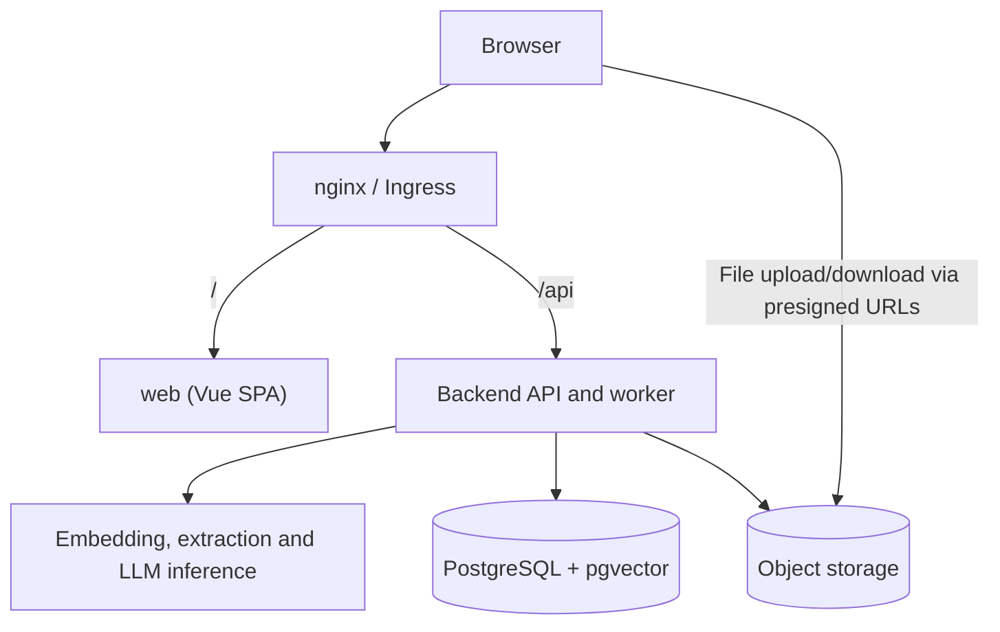

# Application Architecture

## 1. Introduction and System Overview

**Prawobiorca** is a web application providing intelligent legal search and document management capabilities. The system supports AI-assisted (semantic vector search) retrieval of legal acts, as well as case management and document drafting for authenticated users.

The whole application lives in a single repository. Its implementation is described in two dedicated sections:

- [Backend](backend.md): services, background processing, API conventions, Clean Architecture layers and import rules.
- [Frontend](frontend.md): the Vue application, its stack, project structure, API integration and development commands.

## 2. Repository Layout

- `apps/` – deployable applications, each built into its own container image: `core` (main API and Taskiq worker), `extraction`, `embedding` and `web` (frontend).
- `deploy/` – Kubernetes manifests: a shared Kustomize base with overlays for GCP, the local kind cluster and E2E.
- `scripts/` – scripts for running the application locally and deploying it to the cloud.
- `docs/` – this documentation.

Code shared between applications, such as the generated API client, will be moved to `packages/` next to `apps/` once a second application needs it.

## 3. System Components

The system combines a modular monolith for core business logic with specialized services for compute-heavy tasks.

| Component | Role |
| --- | --- |
| `web` | Vue single-page application, built into static assets and served by nginx. |
| `core` API | Authentication, cases, documents, search and application generation requests, and the MCP server for AI assistants. |
| `core` Taskiq worker | Background document processing, indexing and application generation. |
| `embedding`, `extraction`, LLM inference | Text embeddings, PDF text extraction and AI-generated content. |
| PostgreSQL + pgvector | Application data, search vectors and the background task queue. |
| Object storage | Uploaded documents and generated files, stored in RustFS locally or Google Cloud Storage in the cloud. |

The frontend uses the `core` REST API under `/api`. File transfers go directly between the browser and object storage using URLs issued by the API. Backend services handle indexing and generation in the background.

See [Backend](backend.md#2-services-and-communication) for the detailed service diagram and responsibilities, and [Frontend](frontend.md#5-api-integration) for browser-side API integration.

## 4. Deployment Environments

- **Cloud (GCP / Google Cloud Platform)**: containerized workloads, with scale-to-zero for compute services to limit resource use when idle.
- **Local**: the same workloads in a [kind](https://kind.sigs.k8s.io) cluster, with PostgreSQL, RustFS and the compute services running inside it. E2E tests use a second, disposable cluster.

The frontend is served at `/` behind the same ingress as the API. It is stateless from the deployment point of view; session cookies are issued by `core`.

### Manifests (`deploy/`)

Every environment is deployed from the same Kustomize structure by `scripts/deploy.py`:

- `base/` – portable Kubernetes shared by all environments: `core`, `core-worker`, the migrations Job, `web` and PostgreSQL. It contains nothing specific to GKE.
- `overlays/gcp` – GKE patches (Secret Manager CSI volume, service account, spot nodes, Ingress with managed certificates) and the Cloud Run, Vertex AI and Cloud Storage configuration.
- `overlays/kind` – shared by the kind environments: an nginx gateway on `localhost:8080`, RustFS on `localhost:9000`, `embedding`, `extraction`, the LLM on CPU and a test `Secret`.
- `overlays/local` – `kind` with PostgreSQL and RustFS data in the Podman volumes of `just dev`, mounted into the cluster node by `scripts/local/run.py`.
- `overlays/e2e` – `kind` with `extraction` and the LLM scaled to zero, plus the seed Job.
- `kind/cluster.yaml` – the kind cluster: host ports 8080 and 9000, and the host directory with LLM models.

Rules shared by the environments:

- **Images**: manifests use the logical names `prawobiorca/<app>` without a registry or tag; the deployment script always replaces them.
- **Configuration**: the `core-config` ConfigMap is generated from `config.env` files, overlays override single keys. Its name contains a content hash, so a configuration change rolls the pods.
- **Secrets**: always files in `/mnt/secrets-store`, from Secret Manager on GCP and from a plain `Secret` elsewhere. No secrets are passed through environment variables.

A deployment to another Kubernetes cluster is a new overlay over `base/`, reusing the service definitions from `overlays/kind`.

See [CI/CD](../ci_cd.md) for deployment workflows, [Backend](backend.md) for service-specific deployment details, and [Frontend](frontend.md#6-build-and-deployment) for the frontend container and routing.
