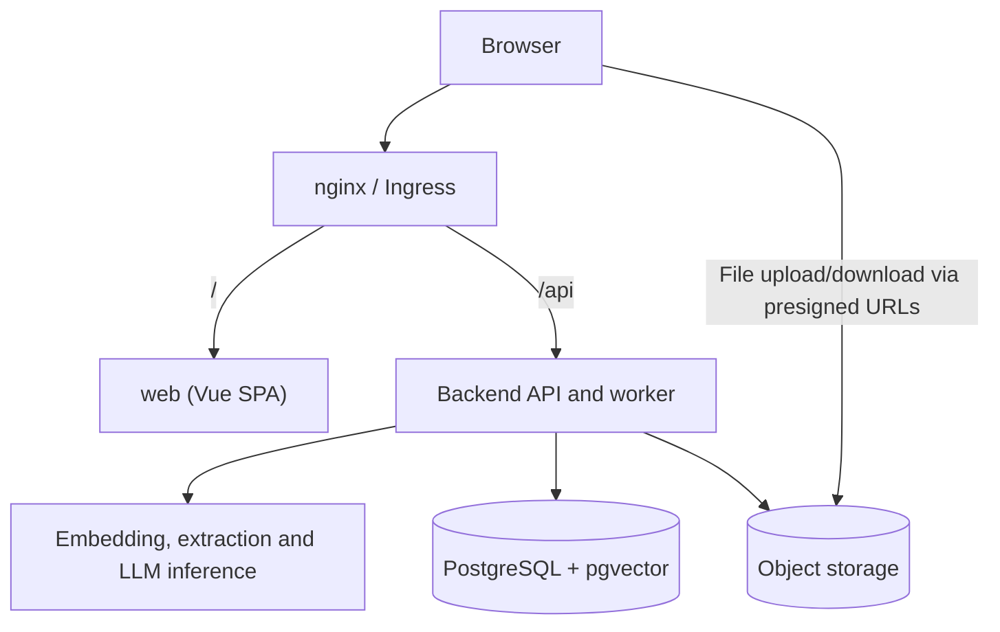

# Application Architecture

## 1. Introduction and System Overview

**Prawobiorca** is a web application providing intelligent legal search and document management capabilities. The system supports AI-assisted (semantic vector search) retrieval of legal acts, as well as case management and document drafting for authenticated users.

The whole application lives in a single repository. Its implementation is described in two dedicated sections:

- [Backend](backend.md): services, background processing, API conventions, Clean Architecture layers and import rules.
- [Frontend](frontend.md): the Vue application, its stack, project structure, API integration and development commands.

## 2. Repository Layout

- `apps/` – deployable applications, each built into its own container image: `core` (main API and Taskiq worker), `extraction`, `embedding` and `web` (frontend).
- `deploy/` – Kubernetes manifests for the local (Podman) and GCP environments.
- `scripts/` – scripts for running the application locally and deploying it to the cloud.
- `docs/` – this documentation.

Code shared between applications, such as the generated API client, will be moved to `packages/` next to `apps/` once a second application needs it.

## 3. System Components

The system combines a modular monolith for core business logic with specialized services for compute-heavy tasks.

| Component | Role |
| --- | --- |
| `web` | Vue single-page application, built into static assets and served by nginx. |
| `core` API | Authentication, cases, documents, search and application generation requests. |
| `core` Taskiq worker | Background document processing, indexing and application generation. |
| `embedding`, `extraction`, LLM inference | Text embeddings, PDF text extraction and AI-generated content. |
| PostgreSQL + pgvector | Application data, search vectors and the background task queue. |
| Object storage | Uploaded documents and generated files, stored in RustFS locally or Google Cloud Storage in the cloud. |

The frontend uses the `core` REST API under `/api`. File transfers go directly between the browser and object storage using URLs issued by the API. Backend services handle indexing and generation in the background.

See [Backend](backend.md#2-services-and-communication) for the detailed service diagram and responsibilities, and [Frontend](frontend.md#5-api-integration) for browser-side API integration.

## 4. Deployment Environments

- **Cloud (GCP / Google Cloud Platform)**: containerized workloads, with scale-to-zero for compute services to limit resource use when idle.
- **On-Premise**: containerized services run with Podman / Docker.

The frontend is served at `/` behind the same ingress as the API. It is stateless from the deployment point of view; session cookies are issued by `core`.

See [CI/CD](../ci_cd.md) for deployment workflows, [Backend](backend.md) for service-specific deployment details, and [Frontend](frontend.md#6-build-and-deployment) for the frontend container and routing.
